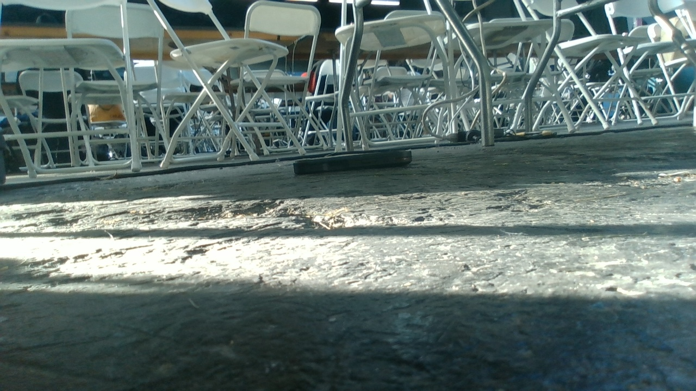
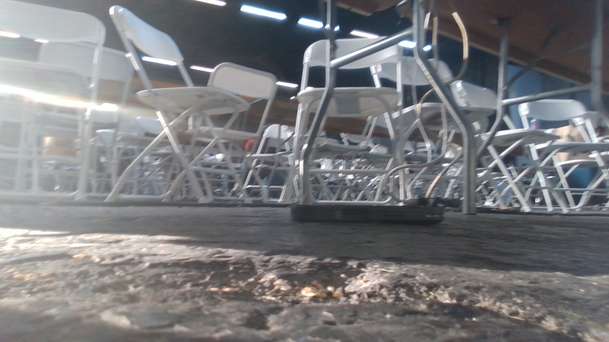
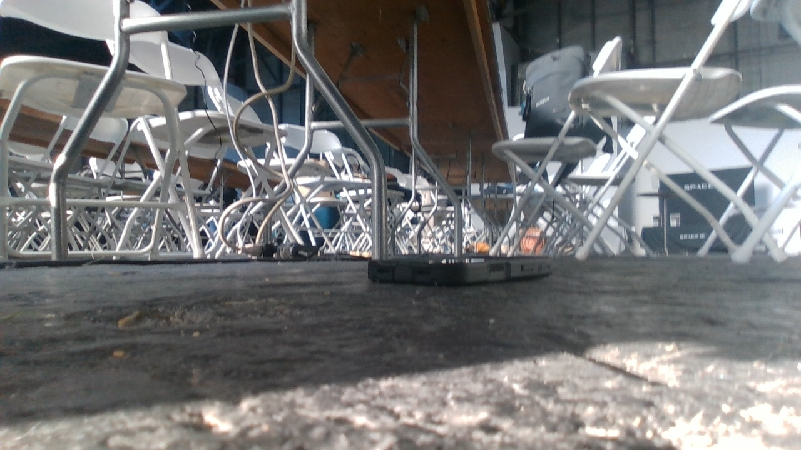
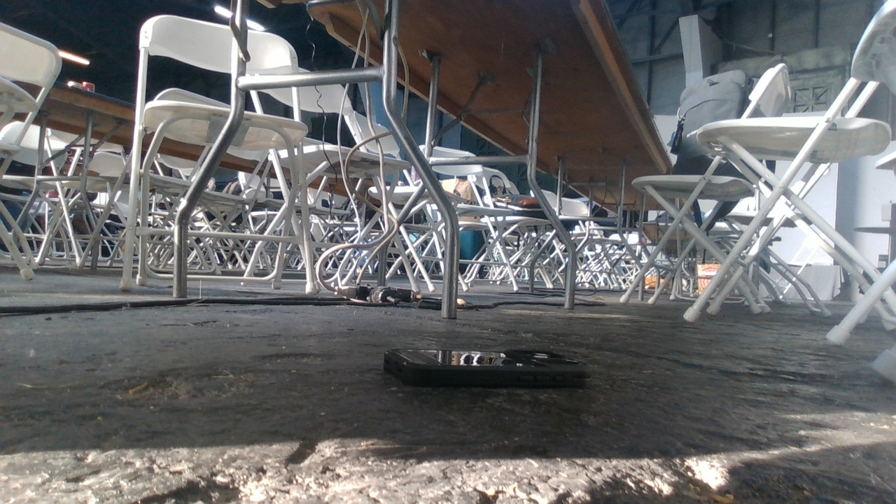
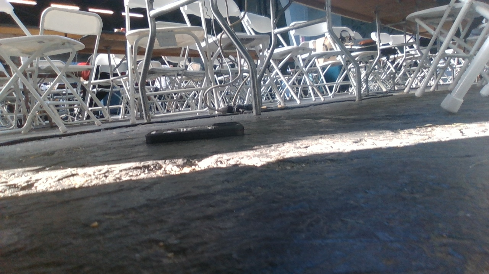
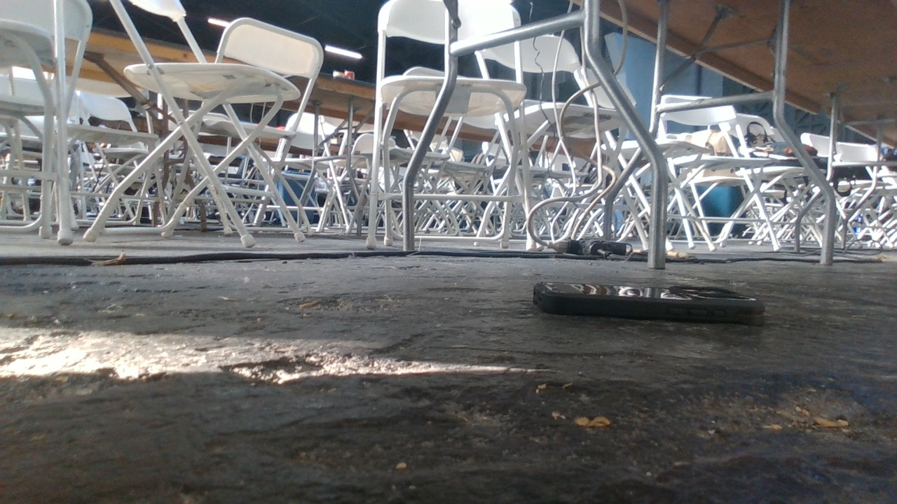

# Phone dataset photo samples

Six original RGB photos from the existing `phone_lowmount` dataset, uploaded at SW2’s request. These illustrate capture conditions and phone placement; they are not new captures or proof of final-mount calibration.

Only these review samples are included; the full dataset, depth images and model weights remain local.

## phone_0000.jpg

Source: `data/datasets/phone_lowmount/images/train/phone_0000.jpg`

## phone_0053.jpg

Source: `data/datasets/phone_lowmount/images/train/phone_0053.jpg`

## phone_0159.jpg

Source: `data/datasets/phone_lowmount/images/train/phone_0159.jpg`

## phone_0212.jpg

Source: `data/datasets/phone_lowmount/images/train/phone_0212.jpg`

## phone_0345.jpg

Source: `data/datasets/phone_lowmount/images/val/phone_0345.jpg`

## phone_0399.jpg

Source: `data/datasets/phone_lowmount/images/val/phone_0399.jpg`

