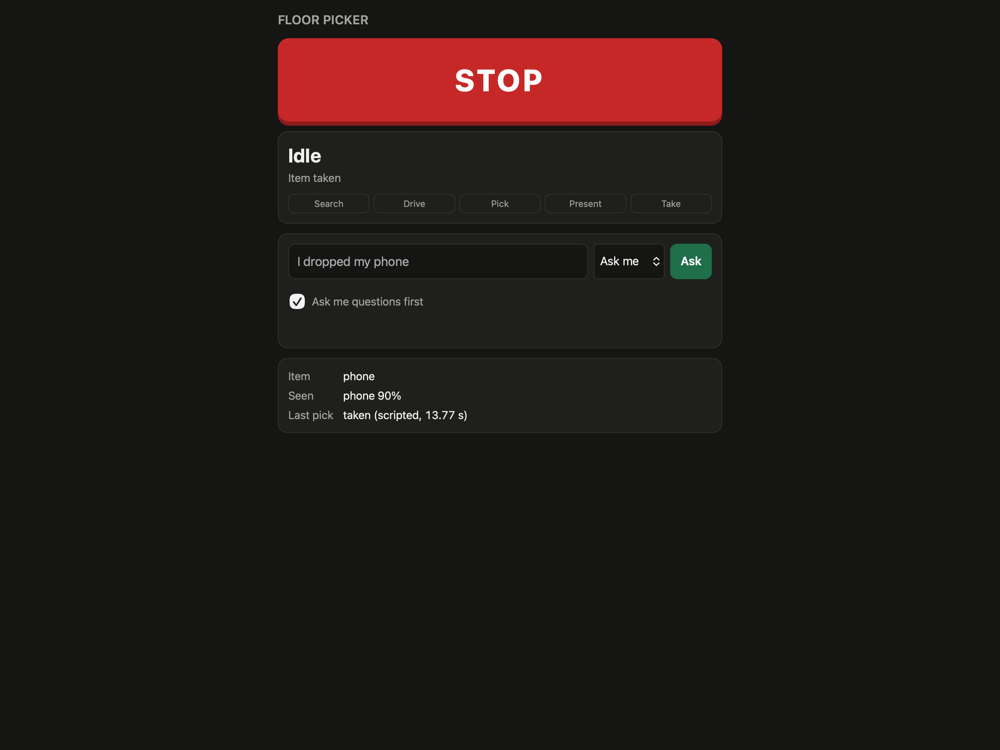
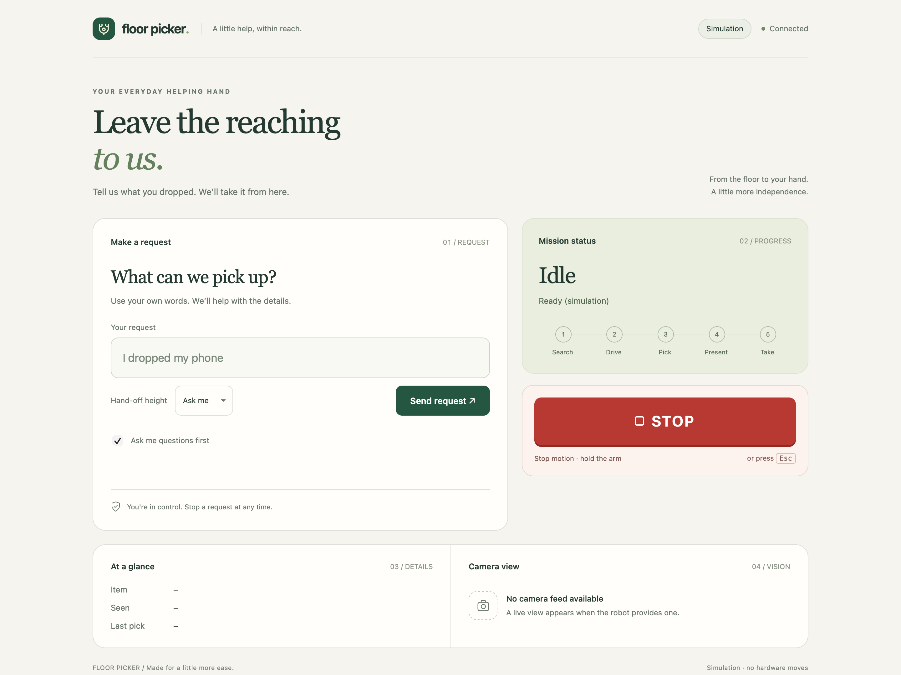
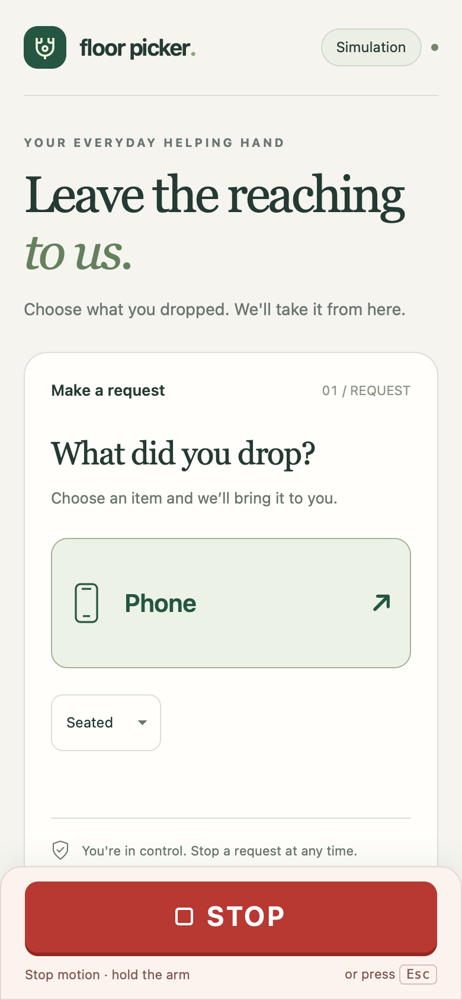
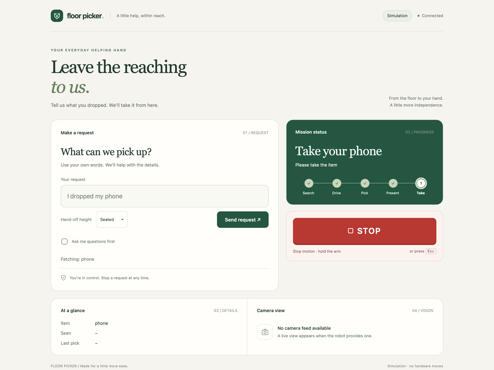
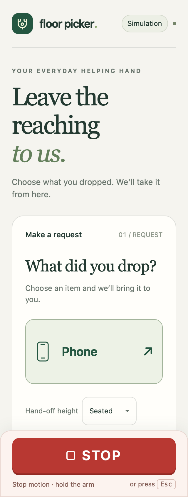
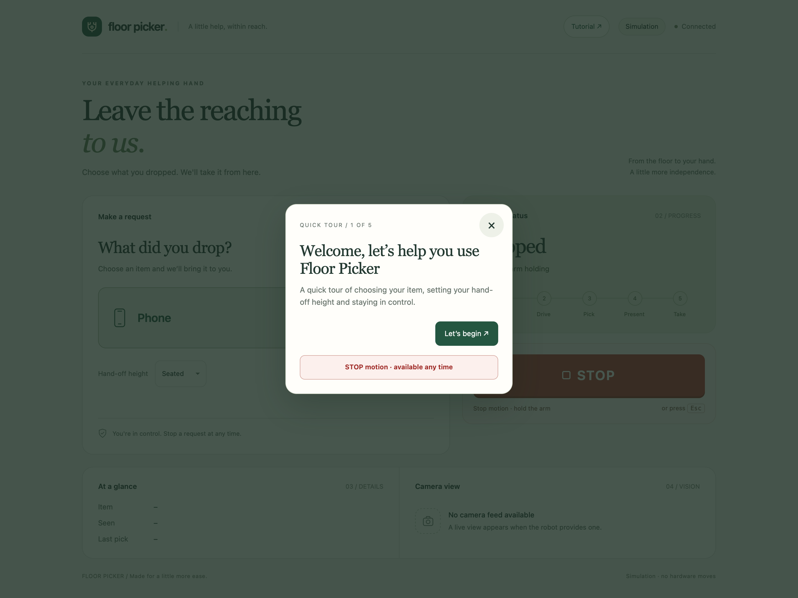
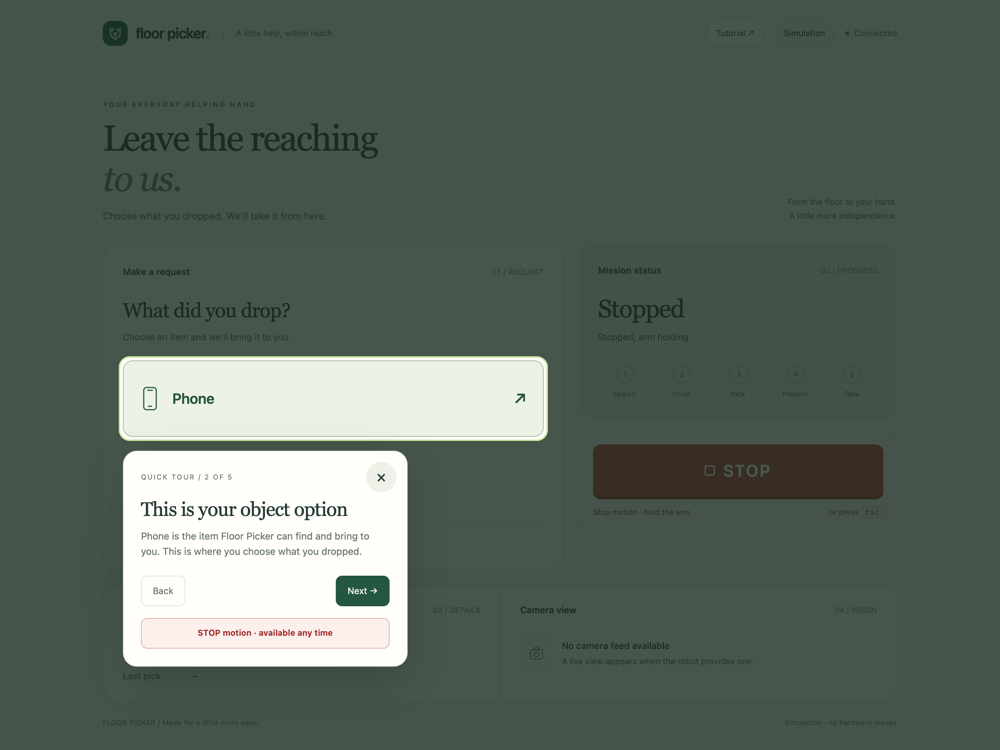
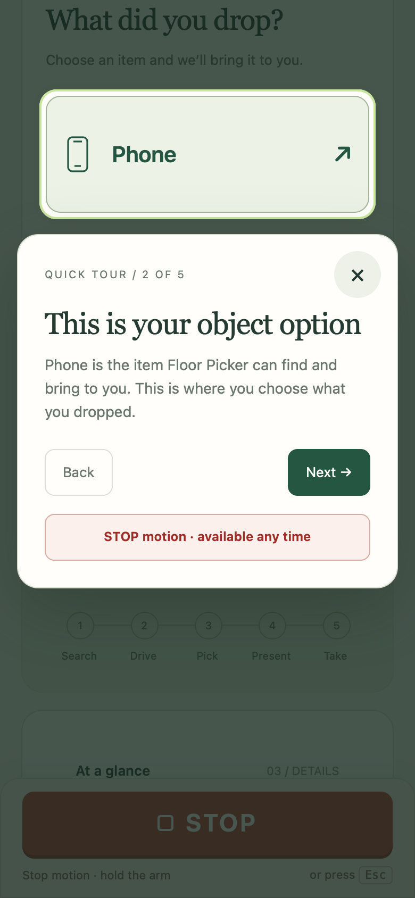

# Floor Picker UI review

Captured from localhost in simulation mode. Photos here are browser screenshots,
not camera feeds. The handoff screenshot uses a simulated status response.

## Before

## After

## Phone layout

## Handoff state

## Validation

- Existing server/request suite: 164 passed, 1 skipped.
- Native macOS WebKit: simulation indicator, a real request to the simulated
  backend, STOP, a mocked disconnected response, handoff and camera empty states.
- 320 px and 390 px layouts: no horizontal overflow; STOP stays visible and at
  least 48 px tall after scrolling. Desktop captured at 1440 × 1080 CSS pixels.
- No hardware was connected or moved during these checks.

## Guided tutorial

The Tutorial button opens a dimmed five-step walkthrough: welcome, Phone option,
Seated/Standing, tap Phone to start, and STOP. The outline and explanation animate
between controls. Next/Back/Close are keyboard accessible; Escape retains STOP
behavior. A STOP control stays available inside the tour. The tour does not start
requests or change the selected handoff height.

WebKit walkthrough checks passed at 1440, 390 and 320 px: all targets stay outlined
and unobscured, dialogs stay inside the viewport, no fetch requests are sent,
Back/Done/Close work, and tutorial STOP reaches the simulated backend. Keyboard
focus wrapping was checked at 320 px. Reduced-motion CSS disables transitions.

